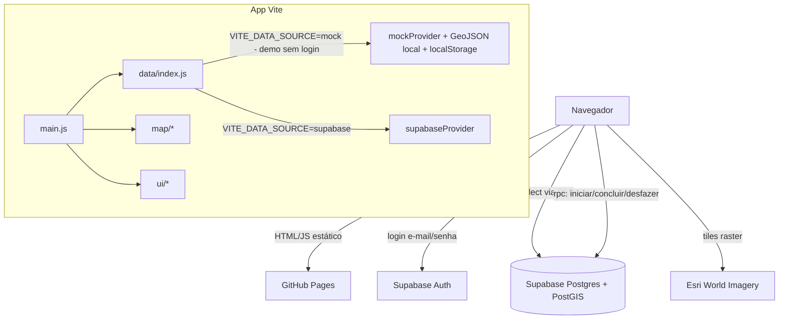
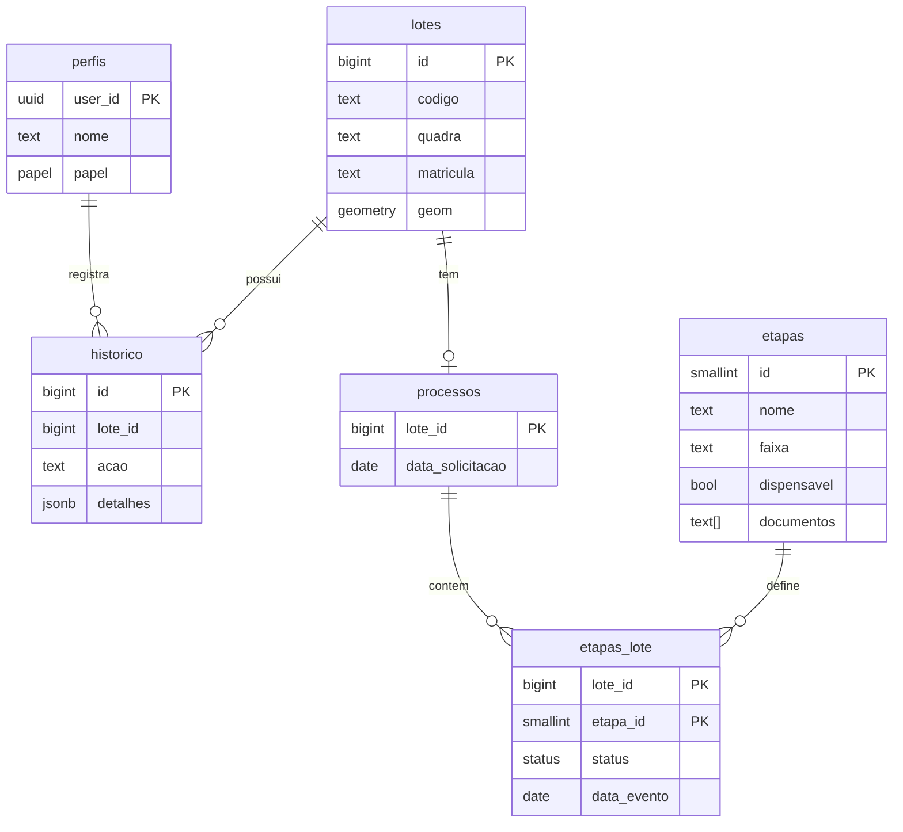

# Plano de Implementação — Geoportal Green Terrenos

## 1. Objetivo

Página web (GitHub Pages) com login (em produção), que mostra **somente os lotes do loteamento Green Terrenos** (Cruz/CE) sobre imagem de satélite e permite **acompanhar e registrar o avanço da transferência de matrícula de cada lote**, etapa por etapa.

O usuário:

1. vê o loteamento colorido conforme a fase do processo de cada lote;
2. clica em um lote → painel lateral esquerdo mostra os dados do imóvel, do adquirente, da prefeitura (BCI) e o acompanhamento;
3. vê abaixo do mapa o **fluxo de 9 etapas** (ícone + nome): concluídas em **verde**, pendentes em **cinza**;
4. clica em uma etapa → abaixo aparecem os **documentos necessários** daquela etapa;
5. se for **admin**, dá **ok** na próxima etapa (ou desfaz a última), com histórico.

---

## 2. Decisões tomadas (grill-me de 13/10/2026)

| # | Tema | Decisão |
|---|---|---|
| 1 | Carga dos lotes | Usuário está elaborando o **arquivo final** e fará a inserção no Supabase **posteriormente**. Plano define o schema e o mapeamento (§ 12). |
| 2 | Pessoas no painel | Apenas o **adquirente (comprador)**. |
| 3 | Fluxo | **9 etapas** (§ 4). BCI é a etapa 1, iniciada quando o adquirente solicita. Em Cruz, o BCI é atualizado junto com o pagamento do ITBI. |
| 4 | Regra do ok | **Sequencial** + histórico (usuário, data/hora, data do evento, observação). Só **admin** dá ok e desfaz. |
| 5 | Documentos | **Só informativo**: lista fixa por etapa, igual para todos os lotes. |
| 6 | Cores | **Faixas**: Disponível / Sem processo / Prefeitura / Cartório / Concluído (§ 4.1). |
| 7 | Acesso | Produção: **tudo atrás do login**, RLS no Supabase. Demo: sem login, só dados fictícios. Nenhum dado pessoal real no repositório. |
| 8 | Perfis | **Admin** e **Leitor**. Contas criadas manualmente no Supabase (sem auto-cadastro). |
| 9 | Edição | Admin edita dados cadastrais pela página; geometria **não** é editável pela página. |
| 10 | Stack | **Vite + JavaScript puro** + MapLibre GL + supabase-js + Tailwind; deploy via GitHub Actions → GitHub Pages. |
| 11 | Mapa | Preso ao loteamento (folga ~200 m, zoom mín. 16), satélite Esri, rótulos a partir do zoom 18, botão “enquadrar”. |
| 12 | Visual | **Tema claro** com cores da marca. Logo Green Terrenos + título no topo; “Um produto Precision+” no rodapé. |
| 14 | Extras | **KPIs** por faixa (6 cards), **busca** por lote/comprador/matrícula, **histórico** do lote. |
| 15 | Painel lateral | Identificação + Adquirente + Prefeitura + Acompanhamento. |
| 16 | Início do processo | Botão **“Iniciar processo”** (admin) registra a data da solicitação e libera a etapa 1. |
| 17 | Desenvolvimento | **Simulação com GeoJSON local** (geometria real dos 79 lotes de `lotes_@.gpkg`, nomes/telefones **fictícios**) enquanto o arquivo final não fica pronto. |
| 18 | Etapa 7 | “Exigências” pode ser marcada como **“Não se aplica”** (verde com traço). |
| 19 | Responsividade | Portal **responsivo, mobile-first**, pensado para uso real em **desktop e celular** (§ 3.2). |
| 20 | Comprador com vários lotes | **Cada processo é único por lote.** Sem “ok em lote”. |
| 21 | Lotes não vendidos | Faixa **Disponível**: contorno tracejado, sem preenchimento. Não permite iniciar processo sem adquirente. |
| 22 | Venda de lote disponível | Admin preenche adquirente + data da compra → lote vira **Sem processo** automaticamente. |
| 23 | Status no arquivo final | Campo inteiro **`etapa` (0–9)** = última etapa concluída; carga marca 1..N como concluídas (§ 12). |
| 24 | Repositório | Conta pessoal do GitHub, **`green-terrenos`** → `https://<usuario>.github.io/green-terrenos/`. |
| 25 | Supabase | Projeto **novo**, criado pelo usuário depois (sugestão: região São Paulo `sa-east-1`). Até lá, só GeoJSON local. |
| 26 | Demo publicada | GitHub Pages em **modo demonstração**: **sem login**, abre direto como **admin**, faixa “DEMONSTRAÇÃO”, dados fictícios. |
| 27 | Camadas do mapa | **Apenas os lotes** (com rótulo do código). Sem contorno do loteamento, rótulos de quadra ou ruas. |
| 28 | Login em produção | E-mail/senha, **“Esqueci a senha”** por e-mail, **sessão lembrada** no aparelho até “Sair”. |
| 29 | Data do evento | **Obrigatória**, padrão hoje, pode ser retroativa, nunca futura. |

---

## 3. Layout da tela

```
┌──────────────────────────────────────────────────────────────────────────────┐
│ [LOGO GREEN]  Gerenciamento de Transferência de Matrículas   [🔍 busca] [👤▾] │  ← cabeçalho
├──────────────────────────────────────────────────────────────────────────────┤
│ Disponível 6 │ Sem processo 56 │ Prefeitura 9 │ Cartório 6 │ Concluído 2 │ Total 79 │ ← KPIs
├────────────────────┬─────────────────────────────────────────────────────────┤
│ PAINEL DO LOTE     │                                                         │
│                    │               MAPA (satélite, preso ao loteamento)      │
│ Lote A6 · Quadra A │                                             [+][-][⌖]  │
│ ▸ Identificação    │   ┌Legenda────────┐                                     │
│ ▸ Adquirente       │   │□ Disponível   │                                     │
│                    │   │■ Sem processo │                                     │
│ ▸ Prefeitura (BCI) │   │■ Prefeitura   │                                     │
│ ▸ Acompanhamento   │   │■ Cartório     │                                     │
│   etapa 4/9 · 44%  │   │■ Concluído    │                                     │
│ ▸ Histórico        │   └───────────────┘                                     │
│ [Editar] (admin)   ├─────────────────────────────────────────────────────────┤
│ [Iniciar processo] │ FLUXO  (1)━(2)━(3)━(4)━(5)┄(6)┄(7)┄(8)┄(9)              │
│                    │        BCI ITBI Guia Pago Prot Emol Exig Reg Matr       │
│                    ├─────────────────────────────────────────────────────────┤
│                    │ DOCUMENTOS — Etapa 5: Protocolo no Registro de Imóveis  │
│                    │ • Escritura pública ou título de transmissão ...        │
│                    │                     [✓ Dar ok nesta etapa] (admin)      │
├────────────────────┴─────────────────────────────────────────────────────────┤
│                       Um produto  [PRECISION+]  · 2026                       │  ← rodapé
└──────────────────────────────────────────────────────────────────────────────┘
```

O desenho acima é o **layout desktop**. O layout de celular está em § 3.2.

- **Sem lote selecionado:** painel mostra instrução (“Toque/clique em um lote no mapa”); fluxo aparece todo cinza e clicável apenas para consulta de documentos.

### 3.1 Identidade visual (tokens)

| Token | Valor | Uso |
|---|---|---|
| `--verde-lima` | `#A8C83A` | destaque, lote selecionado, etapa atual |
| `--verde-escuro` | `#1F6B2E` | títulos, botões primários, etapas concluídas |
| `--laranja` | `#F28C28` | faixa Prefeitura, acentos do Precision+ |
| `--azul` | `#2F6FB5` | faixa Cartório |
| `--cinza` | `#9CA3AF` | faixa Sem processo, etapas pendentes |
| `--disponivel` | `#FFFFFF` (linha tracejada) | faixa Disponível: só contorno, sem preenchimento |
| `--fundo` | `#F6F8F4` | fundo da página |
| `--card` | `#FFFFFF` | cartões |
| `--texto` | `#1F2937` | texto principal |

Tipografia: **Outfit** (Google Fonts). Ícones: **Material Symbols Rounded**.

### 3.2 Responsividade (desktop e celular)

O CSS é escrito **mobile-first** (classes base = celular; `md:`/`lg:` ampliam). Um único HTML/JS atende todos os tamanhos — não há “versão mobile” separada.

#### Pontos de quebra

| Faixa | Largura | Layout |
|---|---|---|
| Celular | < 768 px | **Mapa em tela cheia + gaveta inferior (bottom sheet)** |
| Tablet retrato | 768–1023 px | Igual ao celular, com gaveta mais larga (máx. 640 px, centralizada) |
| Tablet paisagem / notebook | 1024–1279 px | Layout desktop com painel lateral de 300 px |
| Desktop | ≥ 1280 px | Layout desktop com painel de 340 px; conteúdo máx. 1600 px |

#### Layout no celular

```
┌───────────────────────────────┐
│ [🌿] Transf. de Matrículas 🔍 👤│  ← cabeçalho compacto (56 px): ícone do logo,
├───────────────────────────────┤     título abreviado, busca vira ícone
│ ○Disp 6 ●Sem proc 56 ●Pref 9 ›│  ← KPIs como "chips" com rolagem horizontal
├───────────────────────────────┤     (tocar = filtrar o mapa)
│                               │
│        MAPA (tela cheia)      │
│                       [+][-]  │
│  [≡ Legenda]            [⌖]   │
│                               │
├───────────────────────────────┤
│ ▬▬▬                           │  ← gaveta RECOLHIDA (~120 px):
│ Lote A6 · Quadra A  ■Cartório │     lote, adquirente, faixa e
│ D. Teixeira   ▓▓▓▓░░░░ 4/9    │     mini-barra de progresso
└───────────────────────────────┘

Gaveta ABERTA (arrastar para cima ou tocar):
┌───────────────────────────────┐
│ ▬▬▬                     [✕]   │
│ Lote A6 · Quadra A  ■Cartório │
│ [ Dados ] [ Etapas ] [Histórico]│ ← abas
├───────────────────────────────┤
│ ✔ 1 Cadastro imobiliário (BCI)│  ← aba Etapas: fluxo VERTICAL
│ ✔ 2 Solicitação de ITBI       │     (stepper), cada etapa abre
│ ✔ 3 Guia de ITBI emitida      │     em acordeão com seus
│ ✔ 4 ITBI pago (BCI atualizado)│     documentos e o botão de ok
│ ◉ 5 Protocolo no RI       ▾   │
│   • Escritura pública ...     │
│   [ ✓ Dar ok nesta etapa ]    │
│ ○ 6 Emolumentos pagos         │
│ …                             │
│      Um produto PRECISION+    │  ← rodapé dentro da gaveta/menu
└───────────────────────────────┘
```

#### Regras por componente

| Componente | Celular (< 1024 px) | Desktop (≥ 1024 px) |
|---|---|---|
| Cabeçalho | 56 px; ícone do logo; título “Transf. de Matrículas”; busca abre sobreposição em tela cheia | Logo completo + título completo + busca inline |
| KPIs | Chips em linha com rolagem horizontal | 6 cards em grade |
| Mapa | Ocupa `100dvh` menos cabeçalho, chips e gaveta recolhida | Coluna direita, altura ~55 % da tela |
| Painel do lote | **Bottom sheet** com 3 posições (recolhido / meio / cheio), arrastável, com abas Dados · Etapas · Histórico | Coluna esquerda fixa com seções |
| Fluxo de etapas | **Vertical** (stepper) com acordeão de documentos por etapa | **Horizontal** com ícones e conectores; documentos em card abaixo |
| Documentos | Dentro do acordeão da etapa | Card abaixo do fluxo |
| Legenda | Botão “Legenda” que abre/fecha | Card fixo no canto do mapa |
| Modais (ok, desfazer, editar, iniciar) | **Tela cheia** (sheet), botões fixos no rodapé | Diálogo centralizado (máx. 480 px) |
| Rodapé Precision+ | No fim da gaveta e no menu do usuário | Rodapé fixo da página |

O fluxo horizontal e o vertical são **o mesmo componente** (`fluxoEtapas.js`), mudando apenas a direção via CSS (`flex-col lg:flex-row`); os documentos são renderizados por `documentos.js` no acordeão (celular) ou no card (desktop).

#### Toque e usabilidade

- Áreas de toque **≥ 44 × 44 px** (botões, ícones de etapa, chips).
- **Tolerância de toque no mapa:** o clique consulta feições num quadrado de ±8 px (`queryRenderedFeatures` com bbox), pois os lotes são pequenos na tela do celular.
- Ao selecionar um lote no celular, o mapa recentraliza com `padding` inferior igual à altura da gaveta, para o lote não ficar escondido.
- Gestos do mapa: pinça para zoom, arrastar com um dedo; rotação desativada (`dragRotate`/`touchPitch` desligados) para não desorientar.
- Campos de data usam `<input type="date">` nativo; telefone abre discador/WhatsApp.
- Botão voltar do Android/iOS fecha a gaveta/modal antes de sair da página (`history.pushState` ao abrir).
- Textos mínimos de 14 px no celular; contraste AA em todas as cores de faixa (texto sobre selo usa branco ou escuro conforme a cor).

#### Técnica

- `<meta name="viewport" content="width=device-width, initial-scale=1, viewport-fit=cover">`.
- Alturas com `dvh` (evita o bug da barra de endereço do celular) e margens com `env(safe-area-inset-*)` (iPhone com notch).
- `ResizeObserver` no contêiner do mapa → `map.resize()` ao girar a tela ou abrir/fechar a gaveta.
- Sem `backdrop-filter`/blur pesado no celular (desempenho em aparelhos simples).
- `manifest.webmanifest` + ícones → permite **“Adicionar à tela inicial”** e abrir como app (sem modo offline nesta versão).

---

## 4. Fluxo de etapas e documentos

| # | Etapa (nome curto) | Ícone (Material Symbols) | Faixa ao concluir | Dispensável |
|---|---|---|---|---|
| 1 | Cadastro imobiliário (BCI) | `home_work` | Prefeitura | não |
| 2 | Solicitação de ITBI | `request_quote` | Prefeitura | não |
| 3 | ITBI pago (BCI atualizado) | `paid` | Prefeitura | não |
| 4 | Guia de ITBI emitida (só sai após o pagamento) | `receipt_long` | → Cartório | não |
| 5 | Cartório — protocolo no Registro de Imóveis | `account_balance` | Cartório | não |
| 6 | Emolumentos pagos | `payments` | Cartório | não |
| 7 | Exigências | `rule` | Cartório | **sim** |
| 8 | Registro da transferência | `edit_document` | Cartório | não |
| 9 | Matrícula atualizada emitida | `verified` | → Concluído | não |

### 4.1 Regra de faixa (cor do lote)

| Situação | Faixa | Cor |
|---|---|---|
| Sem adquirente (não vendido) | `disponivel` | sem preenchimento, contorno branco **tracejado** |
| Com adquirente, sem processo iniciado | `sem_processo` | cinza `#9CA3AF` |
| Processo iniciado, última etapa concluída < 4 | `prefeitura` | laranja `#F28C28` |
| Última etapa concluída entre 4 e 8 | `cartorio` | azul `#2F6FB5` |
| Etapa 9 concluída | `concluido` | verde `#1F6B2E` |

**Rev04:** em Cruz a guia de ITBI quitada só é emitida **depois** do pagamento, por isso “ITBI pago” é a etapa 3 e “Guia emitida” a 4. Nas etapas 2 e 5 entram também: **certidão de nascimento (solteiro), certidão de casamento (casado) e RG/CPF do cônjuge** — a fonte da verdade da lista de documentos é `src/data/etapas.js`.

**Percentual** no painel = etapas concluídas (inclui “não se aplica”) ÷ 9.

### 4.2 Estados visuais das etapas no fluxo

| Estado | Visual |
|---|---|
| Concluída | círculo verde-escuro, ícone branco, conector verde |
| Não se aplica | círculo verde com ícone riscado/traço, tooltip “Não se aplica” |
| Próxima (pendente liberada) | círculo cinza com **anel verde-lima pulsante** |
| Pendente | círculo cinza-claro, ícone cinza, conector tracejado |
| Selecionada (clicada) | sublinhado/realce + documentos abaixo |

### 4.3 Documentos por etapa (texto informativo)

Derivados de `fluxo_transferencia_matriculas_cruz_ce.md`, ajustados à realidade de Cruz (BCI atualizado junto com o ITBI).

**1 · Cadastro imobiliário (BCI)** — Protocolar no sistema da Prefeitura o cadastro/atualização do imóvel, conferindo endereço, área, lote, quadra, titularidade e inscrição com a matrícula e o levantamento técnico.
- Requerimento
- Matrícula do imóvel
- Planta topográfica
- Memorial descritivo
- Arquivos vetoriais
- Contrato social, quando houver pessoa jurídica
- RG e CPF do representante
- Comprovante de residência do representante (últimos 3 meses)
- Procuração, se o protocolo for feito por terceiro
- Comprovante do BCI ou inscrição imobiliária anterior, se disponível

**2 · Solicitação de ITBI** — Protocolar a solicitação/declaração do ITBI com identificação da operação, imóvel, comprador e vendedor.
- Requerimento assinado pelo comprador e pelo vendedor
- Contrato de compra e venda ou minuta do instrumento de transmissão
- Matrícula do imóvel
- BCI ou número da inscrição imobiliária
- Documentação pessoal do comprador e do vendedor (pessoas físicas)
- RG, CPF e comprovante de residência do representante (últimos 3 meses), quando houver representação
- Contrato social e comprovação de poderes do representante (pessoa jurídica)
- Procuração, se aplicável

**3 · Guia de ITBI emitida** — Setor de Tributos analisa e emite a guia. Conferir na guia:
- Número da matrícula ou inscrição imobiliária
- Nome e CPF/CNPJ das partes
- Valor da operação ou base de cálculo
- Valor do imposto
- Vencimento
- Código de validação, quando houver

**4 · ITBI pago (BCI atualizado)** — Pagar no prazo, enviar o comprovante ao sistema da Prefeitura e conferir a atualização do BCI em nome do adquirente.
- Guia de ITBI
- Comprovante de pagamento
- Certidão, declaração ou validação de quitação do ITBI, quando disponibilizada
- Protocolo ou comprovante de envio no sistema
- BCI atualizado em nome do adquirente

**5 · Protocolo no Registro de Imóveis** — Protocolar o título de transmissão com o ITBI quitado.
- Escritura pública, contrato registrável ou outro título de transmissão
- Guia de ITBI quitada
- Comprovante ou certidão de quitação do ITBI
- Matrícula atualizada
- RG e CPF das partes
- Certidão de casamento ou nascimento, conforme o caso
- Comprovante de residência do representante (últimos 3 meses), quando aplicável
- Contrato social, CNPJ e prova de poderes do representante (pessoa jurídica)
- Procuração, se aplicável
- Requerimento de registro

**6 · Emolumentos pagos** — Pagar o orçamento emitido pelo cartório e enviar o comprovante pelo canal indicado. Conferir no orçamento:
- Prenotação
- Registro da transmissão
- Averbações complementares, se necessárias
- Certidão final da matrícula
- Eventuais atos prévios exigidos
- Comprovante de pagamento enviado ao cartório

**7 · Exigências** *(pode ser “Não se aplica”)* — Cumprir a nota de exigências no prazo indicado.
- Nota de exigências do cartório
- Documentos complementares solicitados
- Comprovantes de cumprimento enviados

**8 · Registro da transferência** — Cartório registra a transmissão; adquirente passa a constar como titular.
- Confirmação do registro (número do ato R-x na matrícula)
- Averbações complementares realizadas, quando necessárias (estado civil, construção, nome, retificação)

**9 · Matrícula atualizada emitida** — Solicitar a certidão da matrícula já em nome do adquirente.
- Matrícula atualizada com o registro da transferência
- Título registrado

---

## 5. Arquitetura



**Princípio central:** a interface fala com uma **camada de dados única** (`src/data/index.js`) com a mesma interface para mock e Supabase. Trocar de mock para produção = mudar uma variável de ambiente.

### 5.1 Interface da camada de dados

```js
// src/data/index.js — contrato implementado por mockProvider e supabaseProvider
exigeLogin                           // true no supabase; false no mock (demo abre direto como admin)
entrar(email, senha)                 // → { usuario, perfil: { nome, papel } }
recuperarSenha(email)                // supabase: resetPasswordForEmail
sair()
sessaoAtual()                        // → sessão ou null (mock: sempre { perfil: { nome: 'Demonstração', papel: 'admin' } })
listarEtapas()                       // → [{ id, nome, nome_curto, icone, faixa, dispensavel, descricao, documentos[] }]
listarLotes()                        // → FeatureCollection (properties = colunas de vw_lotes_mapa)
obterLote(id)                        // → { lote, etapas_lote[], historico[] }
iniciarProcesso(loteId, dataSolicitacao)
concluirEtapa(loteId, etapaId, { dataEvento, observacao, naoSeAplica })
desfazerUltimaEtapa(loteId, motivo)
atualizarLote(loteId, campos)        // somente campos cadastrais permitidos
```

### 5.2 Estrutura de pastas

```
green-terrenos/
├─ index.html
├─ package.json
├─ vite.config.js              # base: '/green-terrenos/' (nome do repositório)
├─ .env.example                # VITE_DATA_SOURCE, VITE_SUPABASE_URL, VITE_SUPABASE_ANON_KEY
├─ .gitignore                  # node_modules, dist, .env, "dados antigos/"  ← IMPORTANTE
├─ public/
│  ├─ manifest.webmanifest     # "Adicionar à tela inicial"
│  ├─ img/icone-192.png, icone-512.png   # ícone (folha do logo) para celular
│  ├─ img/logo-green-terrenos.png
│  ├─ img/precision-plus.png
│  └─ mock/lotes.geojson       # geometria real + atributos fictícios
├─ src/
│  ├─ main.js                  # bootstrap: exigeLogin? sessão → login ou app : app (demo)
│  ├─ styles.css               # Tailwind + tokens (§ 3.1)
│  ├─ config.js                # cores das faixas, bounds, zoom, centro
│  ├─ estado.js                # estado global simples (lote selecionado, etapa selecionada, perfil)
│  ├─ data/
│  │  ├─ index.js
│  │  ├─ supabaseProvider.js
│  │  ├─ mockProvider.js
│  │  └─ mock/etapas.json      # mesmo conteúdo do seed SQL (§ 4)
│  ├─ map/
│  │  ├─ mapa.js               # criação, maxBounds, controles, enquadrar
│  │  └─ camadas.js            # fill / line / selecionado / rótulos / legenda
│  ├─ ui/
│  │  ├─ login.js
│  │  ├─ cabecalho.js
│  │  ├─ kpis.js
│  │  ├─ busca.js
│  │  ├─ painelLote.js
│  │  ├─ formEdicaoLote.js
│  │  ├─ historico.js
│  │  ├─ fluxoEtapas.js
│  │  ├─ documentos.js
│  │  ├─ modalOk.js            # ok / não se aplica / desfazer
│  │  ├─ gaveta.js             # bottom sheet do celular (3 posições, arrastável, abas)
│  │  ├─ layout.js             # detecta faixa de tela (matchMedia) e reposiciona painel/documentos
│  │  └─ toast.js
│  └─ util/
│     ├─ html.js               # escape de HTML (todo dado vindo do banco passa aqui)
│     └─ formatos.js           # datas pt-BR, m², telefone
├─ supabase/
│  ├─ migrations/
│  │  ├─ 001_schema.sql
│  │  ├─ 002_funcoes.sql
│  │  ├─ 003_rls.sql
│  │  └─ 004_seed_etapas.sql
│  └─ carga/
│     └─ carga_inicial.sql      # staging lotes_import → lotes/processos/etapas_lote (§ 12.2)
├─ scripts/
│  └─ gerar_mock.py            # GPKG → public/mock/lotes.geojson (atributos fictícios)
├─ docs/
│  └─ IMPORTACAO_LOTES.md      # escrito na fase de carga (§ 12)
└─ .github/workflows/deploy.yml
```

### 5.3 Dependências

| Pacote | Uso |
|---|---|
| `vite` | build/dev server |
| `maplibre-gl` (v5.x estável) | mapa WebGL |
| `@supabase/supabase-js` (v2) | auth + banco |
| `tailwindcss` v4 + `@tailwindcss/vite` | estilos |

Sem framework de UI. Fontes e ícones via Google Fonts.

---

## 6. Banco de dados (Supabase)

### 6.1 Modelo



### 6.2 `001_schema.sql`

```sql
create extension if not exists postgis;

create type papel_usuario as enum ('admin', 'leitor');
create type status_etapa  as enum ('concluida', 'nao_aplica');

create table perfis (
  user_id uuid primary key references auth.users on delete cascade,
  nome    text not null,
  papel   papel_usuario not null default 'leitor'
);

create table etapas (
  id          smallint primary key,
  nome        text not null,
  nome_curto  text not null,
  icone       text not null,
  dispensavel boolean not null default false,
  descricao   text,
  documentos  text[] not null default '{}'
);

create table lotes (
  id                  bigint generated always as identity primary key,
  codigo              text not null,              -- ex.: 'A6' ou 'A1 - A2 - A3 - A4' (NÃO é único, ver § 12.1)
  quadra              text generated always as (upper(left(codigo, 1))) stored,
  matricula           text not null unique,       -- chave natural: 1 polígono = 1 matrícula
  area_m2             numeric(10,2),
  perimetro_m         numeric(10,2),
  adquirente_nome     text,
  adquirente_telefone text,
  data_compra         date,
  bci_inscricao       text,
  data_itbi           date,
  data_ultimo_contato date,
  observacoes         text,
  geom                geometry(MultiPolygon, 4326) not null,
  atualizado_em       timestamptz not null default now(),
  atualizado_por      uuid references auth.users
);
create index lotes_geom_idx on lotes using gist (geom);

create table processos (
  lote_id          bigint primary key references lotes on delete cascade,
  data_solicitacao date not null,
  iniciado_por     uuid references auth.users default auth.uid(),
  iniciado_em      timestamptz not null default now()
);

create table etapas_lote (
  lote_id       bigint   references processos (lote_id) on delete cascade,
  etapa_id      smallint references etapas,
  status        status_etapa not null,
  data_evento   date,
  observacao    text,
  concluido_por uuid references auth.users default auth.uid(),
  concluido_em  timestamptz not null default now(),
  primary key (lote_id, etapa_id)
);

create table historico (
  id         bigint generated always as identity primary key,
  lote_id    bigint not null references lotes on delete cascade,
  acao       text not null check (acao in
             ('iniciar_processo','concluir_etapa','nao_aplica_etapa','desfazer_etapa','editar_cadastro')),
  etapa_id   smallint references etapas,
  detalhes   jsonb,
  usuario_id uuid references auth.users default auth.uid(),
  criado_em  timestamptz not null default now()
);
create index historico_lote_idx on historico (lote_id, criado_em desc);

-- Visão consumida pelo mapa, KPIs, busca e painel
create view vw_lotes_mapa with (security_invoker = true) as
select
  l.id, l.codigo, l.quadra, l.matricula, l.area_m2, l.perimetro_m,
  l.adquirente_nome, l.adquirente_telefone, l.data_compra,
  l.bci_inscricao, l.data_itbi, l.data_ultimo_contato, l.observacoes,
  p.data_solicitacao,
  coalesce(max(el.etapa_id), 0)                                  as ultima_etapa,
  case
    when p.lote_id is null and nullif(trim(l.adquirente_nome), '') is null then 'disponivel'
    when p.lote_id is null                    then 'sem_processo'
    when coalesce(max(el.etapa_id), 0) >= 9   then 'concluido'
    when coalesce(max(el.etapa_id), 0) >= 4   then 'cartorio'
    else 'prefeitura'
  end                                                            as faixa,
  st_asgeojson(l.geom)::json                                     as geometria
from lotes l
left join processos   p  on p.lote_id  = l.id
left join etapas_lote el on el.lote_id = l.id
group by l.id, p.lote_id, p.data_solicitacao;
```

### 6.3 `002_funcoes.sql` — regras de negócio no banco

Toda escrita de processo/etapas acontece **somente** por funções `security definer`, que validam papel e sequência. Assim nem um cliente malicioso consegue pular etapas.

```sql
create or replace function is_usuario() returns boolean
language sql stable security definer set search_path = public as $$
  select exists (select 1 from perfis where user_id = auth.uid());
$$;

create or replace function is_admin() returns boolean
language sql stable security definer set search_path = public as $$
  select exists (select 1 from perfis where user_id = auth.uid() and papel = 'admin');
$$;

create or replace function iniciar_processo(p_lote bigint, p_data date)
returns void language plpgsql security definer set search_path = public as $$
begin
  if not is_admin() then raise exception 'Apenas administradores podem iniciar processos.'; end if;
  if p_data > current_date then raise exception 'A data não pode ser futura.'; end if;
  if (select nullif(trim(adquirente_nome), '') from lotes where id = p_lote) is null then
    raise exception 'Lote disponível: informe o adquirente antes de iniciar o processo.';
  end if;
  insert into processos (lote_id, data_solicitacao) values (p_lote, p_data);
  insert into historico (lote_id, acao, detalhes)
  values (p_lote, 'iniciar_processo', jsonb_build_object('data_solicitacao', p_data));
end $$;

create or replace function concluir_etapa(
  p_lote bigint, p_etapa smallint, p_data_evento date,
  p_observacao text default null, p_nao_aplica boolean default false)
returns void language plpgsql security definer set search_path = public as $$
declare v_ultima smallint;
begin
  if not is_admin() then raise exception 'Apenas administradores podem concluir etapas.'; end if;
  if p_data_evento is null or p_data_evento > current_date then
    raise exception 'Informe a data do evento (não pode ser futura).';
  end if;
  if not exists (select 1 from processos where lote_id = p_lote) then
    raise exception 'Processo não iniciado para este lote.';
  end if;
  select coalesce(max(etapa_id), 0) into v_ultima from etapas_lote where lote_id = p_lote;
  if p_etapa <> v_ultima + 1 then
    raise exception 'A próxima etapa a concluir é a %.', v_ultima + 1;
  end if;
  if p_nao_aplica and not (select dispensavel from etapas where id = p_etapa) then
    raise exception 'Esta etapa não pode ser marcada como "não se aplica".';
  end if;
  insert into etapas_lote (lote_id, etapa_id, status, data_evento, observacao)
  values (p_lote, p_etapa,
          case when p_nao_aplica then 'nao_aplica' else 'concluida' end::status_etapa,
          p_data_evento, p_observacao);
  insert into historico (lote_id, acao, etapa_id, detalhes)
  values (p_lote, case when p_nao_aplica then 'nao_aplica_etapa' else 'concluir_etapa' end, p_etapa,
          jsonb_build_object('data_evento', p_data_evento, 'observacao', p_observacao));
end $$;

create or replace function desfazer_ultima_etapa(p_lote bigint, p_motivo text)
returns void language plpgsql security definer set search_path = public as $$
declare v_ultima smallint;
begin
  if not is_admin() then raise exception 'Apenas administradores podem desfazer etapas.'; end if;
  if coalesce(trim(p_motivo), '') = '' then raise exception 'Informe o motivo.'; end if;
  select max(etapa_id) into v_ultima from etapas_lote where lote_id = p_lote;
  if v_ultima is null then raise exception 'Nenhuma etapa concluída.'; end if;
  delete from etapas_lote where lote_id = p_lote and etapa_id = v_ultima;
  insert into historico (lote_id, acao, etapa_id, detalhes)
  values (p_lote, 'desfazer_etapa', v_ultima, jsonb_build_object('motivo', p_motivo));
end $$;

-- Registra no histórico as edições cadastrais feitas pelo admin (somente campos alterados)
create or replace function trg_lotes_auditoria() returns trigger
language plpgsql security definer set search_path = public as $$
declare v_dif jsonb;
begin
  if nullif(trim(new.adquirente_nome), '') is null
     and exists (select 1 from processos where lote_id = new.id) then
    raise exception 'Não é possível remover o adquirente de um lote com processo iniciado.';
  end if;
  select jsonb_object_agg(n.key, jsonb_build_object('de', o.value, 'para', n.value))
    into v_dif
    from jsonb_each(to_jsonb(new) - 'geom' - 'atualizado_em' - 'atualizado_por') n
    join jsonb_each(to_jsonb(old)) o using (key)
   where n.value is distinct from o.value;
  new.atualizado_em := now();
  new.atualizado_por := auth.uid();
  if v_dif is not null then
    insert into historico (lote_id, acao, detalhes) values (new.id, 'editar_cadastro', v_dif);
  end if;
  return new;
end $$;

create trigger lotes_auditoria before update on lotes
for each row execute function trg_lotes_auditoria();
```

### 6.4 `003_rls.sql` — segurança

```sql
alter table perfis      enable row level security;
alter table etapas      enable row level security;
alter table lotes       enable row level security;
alter table processos   enable row level security;
alter table etapas_lote enable row level security;
alter table historico   enable row level security;

-- Leitura: qualquer usuário com perfil cadastrado
create policy ler_etapas      on etapas      for select to authenticated using (is_usuario());
create policy ler_lotes       on lotes       for select to authenticated using (is_usuario());
create policy ler_processos   on processos   for select to authenticated using (is_usuario());
create policy ler_etapas_lote on etapas_lote for select to authenticated using (is_usuario());
create policy ler_historico   on historico   for select to authenticated using (is_usuario());
create policy ler_perfis      on perfis      for select to authenticated using (is_usuario());

-- Edição cadastral: só admin e só colunas permitidas (geometria/código/matrícula bloqueados)
create policy admin_edita_lotes on lotes for update to authenticated
  using (is_admin()) with check (is_admin());
revoke update on lotes from authenticated, anon;
grant update (adquirente_nome, adquirente_telefone, data_compra, bci_inscricao,
              data_itbi, data_ultimo_contato, observacoes) on lotes to authenticated;

-- processos / etapas_lote / historico: sem policies de insert/update/delete
-- → escrita apenas pelas funções security definer (§ 6.3)
revoke all on processos, etapas_lote, historico from anon;
grant execute on function iniciar_processo, concluir_etapa, desfazer_ultima_etapa to authenticated;
revoke execute on function iniciar_processo, concluir_etapa, desfazer_ultima_etapa from anon;
```

**Configurações no painel do Supabase:**
- Authentication → **desativar “Allow new users to sign up”**.
- Criar usuários em Authentication → Users e inserir a linha correspondente em `perfis` (nome + papel).
- Database → Extensions → confirmar **PostGIS** ativo.

### 6.5 `004_seed_etapas.sql`

Insere as 9 etapas da § 4 (nome, nome_curto, ícone, dispensável, descrição e `documentos` como `text[]`). O mesmo conteúdo fica em `src/data/mock/etapas.json` para o modo mock — **uma única fonte**: o script de seed SQL é gerado a partir do JSON (ou vice-versa) para não divergirem.

---

## 7. Mapa (MapLibre)

| Item | Especificação |
|---|---|
| Fundo | Esri World Imagery (raster, `maxzoom` **17**, overzoom até 20) — nos níveis 18 e 19 a Esri ainda não tem imagem desta área (“Map data not yet available”) |
| Centro inicial | `[-40.39739, -2.88474]` + `fitBounds` nos lotes ao carregar |
| Extensão dos lotes | lon −40.39920 a −40.39557 · lat −2.88520 a −2.88428 |
| `maxBounds` (folga ~600 m) | `[[-40.4047, -2.8907], [-40.3901, -2.8788]]` — com 200 m o celular em pé não conseguia mostrar o loteamento inteiro |
| Zoom | `minZoom` 15 · `maxZoom` 20 |
| Camadas de referência | **Nenhuma** além dos lotes (sem contorno do loteamento, quadras ou ruas) |
| Camada `lotes-fill` | `fill-color` por `faixa` (§ 4.1), opacidade 0.55 (0.80 no hover); `disponivel` com opacidade 0 (só contorno), mas continua clicável |
| Camada `lotes-line` | contorno branco 1.2 px (2.5 px no hover) — exceto `disponivel` |
| Camada `lotes-disponivel-line` | contorno branco **tracejado** (`line-dasharray [2, 2]`), 1.5 px, filtro `faixa == 'disponivel'` |
| Camada `lote-selecionado` | contorno verde-lima `#A8C83A` 4 px, filtro pelo `id` selecionado |
| Camada `lotes-rotulo` | `symbol` com `codigo`, `minzoom` 18, halo escuro. Requer `glyphs` — usar `https://demotiles.maplibre.org/font/{fontstack}/{range}.pbf` |
| Controles | zoom (+/−), **botão “enquadrar loteamento”**, escala |
| Legenda | card fixo no canto inferior esquerdo (botão no celular) com as 5 faixas e contagens |
| Interação | hover via `feature-state`; clique → seleciona lote, abre painel, carrega etapas; clique fora → limpa seleção |
| CRS | dados de origem em SIRGAS 2000 (EPSG:4674) → gravados em **EPSG:4326** (diferença desprezível; `ST_Transform` na carga) |

Sem popup do MapLibre: as informações vão para o painel lateral.

---

## 8. Componentes da interface

### 8.1 Login (`ui/login.js`)
**Somente no modo Supabase.** Tela centralizada: logo Green Terrenos, título, campos e-mail/senha, botão **Entrar**, mensagem de erro em pt-BR. Sem “cadastre-se”. Link **“Esqueci a senha”** → `resetPasswordForEmail` + tela de definir nova senha (evento `PASSWORD_RECOVERY`). Sessão lembrada no aparelho (`persistSession: true`) até o usuário clicar em **Sair**.

**Modo demonstração (mock):** não há tela de login; a página abre direto como **admin** com uma faixa amarela fixa “DEMONSTRAÇÃO — dados fictícios”.

### 8.2 Cabeçalho (`ui/cabecalho.js`)
Logo (altura 48 px) + **“Gerenciamento de Transferência de Matrículas”** + subtítulo “Loteamento Green Terrenos · Cruz/CE”. À direita: busca e menu do usuário (nome, papel, **Sair**). Na demo, o menu mostra “Demonstração (admin)” e **“Restaurar dados de demonstração”** no lugar de Sair.

### 8.3 KPIs (`ui/kpis.js`)
6 cards: Disponível · Sem processo · Prefeitura · Cartório · Concluído · Total. Cada card com a cor da faixa; **clicar filtra/realça** os lotes daquela faixa no mapa (clicar de novo remove o filtro).

### 8.4 Busca (`ui/busca.js`)
Campo com autocomplete (mín. 1 caractere) sobre `codigo`, `adquirente_nome` e `matricula`, sem diferenciar acentos/maiúsculas. Selecionar → `fitBounds` no lote + seleciona.

### 8.5 Painel do lote (`ui/painelLote.js`)

| Seção | Campos |
|---|---|
| Identificação | Lote, Quadra, Matrícula, Área (m²), Perímetro (m) |
| Adquirente | Nome, Telefone (link `tel:`/WhatsApp), Data da compra |
| Prefeitura | BCI / inscrição imobiliária (ou selo “Ainda não cadastrado”), Data do ITBI |
| Acompanhamento | Faixa (selo colorido), Etapa atual “4 de 9 — ITBI pago”, barra de progresso %, Data da solicitação, Data do último contato, Observações |
| Histórico | Linha do tempo (mais recente primeiro): ação, etapa, data do evento, observação, usuário, data/hora |

Lote **Disponível**: o painel mostra Identificação + selo “Lote disponível” (sem seções de adquirente/processo).

Ações (somente admin):
- **Editar** → `formEdicaoLote.js` com os 7 campos editáveis (§ 6.4). Em lote disponível, preencher **adquirente + data da compra** faz o lote virar **Sem processo** automaticamente (a faixa é calculada). Não é permitido apagar o adquirente de lote com processo iniciado.
- **Iniciar processo** (somente se `sem_processo`) → modal pede **data da solicitação** (padrão hoje, não futura).
- Cada lote tem **processo próprio**: oks nunca são replicados para outros lotes do mesmo comprador.

### 8.6 Fluxo de etapas (`ui/fluxoEtapas.js`)
Desktop: barra horizontal com 9 ícones circulares + nome curto + conectores. Celular: lista vertical (stepper) com acordeão de documentos (§ 3.2). Estados da § 4.2 nos dois modos. Clique numa etapa → seleciona e mostra documentos. Ao selecionar um lote, a etapa selecionada por padrão é a **próxima pendente**.

### 8.7 Documentos (`ui/documentos.js`)
Título “Etapa N — Nome”, descrição curta e lista de documentos (§ 4.3). Rodapé do card, conforme o caso:

| Condição | Botão |
|---|---|
| admin + lote com processo + etapa é a próxima | **✓ Dar ok nesta etapa** (e **Não se aplica** se dispensável) |
| admin + etapa é a última concluída | **↶ Desfazer** |
| etapa concluída | selo “Concluída em dd/mm/aaaa por Fulano” |
| leitor ou sem lote | nenhum botão |

### 8.8 Modal de ok (`ui/modalOk.js`)
- **Ok:** data do evento (obrigatória, padrão hoje, não futura), observação (opcional) → `concluirEtapa`.
- **Não se aplica:** observação obrigatória.
- **Desfazer:** motivo obrigatório + confirmação.
Após sucesso: toast, recarrega o lote, atualiza cor no mapa (`setData` na fonte) e KPIs.

### 8.9 Rodapé
“Um produto” + logo **Precision+** (altura 32 px) · ano corrente.

---

## 9. Modo demonstração / simulação (GeoJSON local)

Enquanto o usuário finaliza o arquivo de lotes e não cria o Supabase, **todo o portal roda sobre um GeoJSON local** — em `npm run dev` e na demo publicada.

- `scripts/gerar_mock.py <caminho do lotes_@.gpkg>` → lê a camada `reprojetadoa` (79 lotes), mantém **geometria, código do lote, matrícula, área e perímetro** e gera **nomes e telefones fictícios** (lista fixa de nomes inventados, telefones `(88) 90000-00NN`). Saída: `public/mock/lotes.geojson`.
- O GeoJSON já sai no **mesmo formato do arquivo final** (incluindo o campo `etapa` 0–9, § 12), para a simulação também validar a regra de carga.
- Distribuição de exemplo para exercitar todas as cores: ~6 **disponíveis** (sem adquirente), ~55 sem processo e os demais espalhados entre Prefeitura, Cartório e Concluído (incluindo 1 lote com etapa 7 “Não se aplica”).
- Script roda com `python -I` e só usa `sqlite3` + parsing de geometria GPKG (ou `ogr2ogr`/`geopandas`, se instalado).
- `mockProvider.js`: `exigeLogin = false`, perfil fixo **admin**; guarda processos/etapas/edições/histórico no **localStorage** (com `try/catch`), aplicando as **mesmas regras** das funções SQL (sequência, dispensável, data obrigatória/não futura, adquirente obrigatório para iniciar). “Restaurar dados de demonstração” volta ao GeoJSON original.
- **Nenhum nome, CPF ou telefone real entra no repositório.** A pasta `dados antigos/` fica no `.gitignore`.
- Quando o arquivo final ficar pronto, basta regerar o mock (se quiser testar com ele anonimizado) ou seguir direto para a carga no Supabase (§ 12).

---

## 10. Deploy (GitHub Pages)

1. Repositório **público** `green-terrenos` na **conta pessoal** do GitHub (`base: '/green-terrenos/'` no `vite.config.js`).
2. Settings → Pages → Source: **GitHub Actions**.
3. **Primeira publicação = demo** (`VITE_DATA_SOURCE=mock`, sem login, dados fictícios) para validar com sócios/clientes e testar em celulares reais.
4. Settings → Secrets and variables → Actions:
   - Variable `VITE_DATA_SOURCE` = `mock` (demo) → depois `supabase`
   - Secret `VITE_SUPABASE_URL`, Secret `VITE_SUPABASE_ANON_KEY` (a anon key é pública por natureza; a proteção real é a RLS)
5. `.github/workflows/deploy.yml`: on push em `main` → `npm ci` → `npm test` → `npm run build` (com as variáveis acima) → `actions/upload-pages-artifact` (`dist/`) → `actions/deploy-pages`.
6. Ao migrar para produção: criar projeto Supabase novo (região `sa-east-1`), rodar as migrations, e em Authentication → URL Configuration adicionar `https://<usuario>.github.io/green-terrenos/` como Site URL / Redirect URL (necessário para “Esqueci a senha”).

---

## 11. Segurança e LGPD

- **Demo sem login é aceitável apenas porque só contém dados fictícios.** A troca para `VITE_DATA_SOURCE=supabase` liga o login obrigatório automaticamente.
- Produção: login obrigatório; sem auto-cadastro; RLS em todas as tabelas; escrita de etapas só via funções que checam `is_admin()`.
- Geometria e colunas de identificação não editáveis pela página (`grant update` por coluna).
- **Todo texto vindo do banco é escapado** antes de ir ao DOM (`util/html.js`) — evita XSS por nome/observação.
- Nenhum dado pessoal real em commits, mocks, prints ou issues.
- A `service_role key` do Supabase **nunca** vai para o front-end nem para o repositório.
- Histórico é somente-inclusão (sem update/delete pelo cliente) → trilha de auditoria.

---

## 12. Carga dos lotes reais (fase posterior, feita pelo usuário)

**Origem:** **arquivo final** que o usuário está elaborando no QGIS (base atual: `lotes_@.gpkg`, camada `reprojetadoa` — 79 lotes, quadras A–F, EPSG:4674). As divergências de compradores entre arquivos antigos serão resolvidas pelo usuário nesse arquivo final.

> **Achado na base atual (13/10/2026):** cada polígono é uma **matrícula**, não um lote. São 79 matrículas
> distintas e só 70 códigos de lote: há códigos que agrupam lotes (`A1 - A2 - A3 - A4`) e códigos repetidos
> (`B8` aparece em 3 matrículas; `A11`, `D11`, `D16`, `E14`, `E15`, `A17 - A18`, `D13 - D14` em 2).
> Por isso a chave única é `matricula`, e a interface sempre mostra “Lote X · Matrícula Y”.

### 12.1 Campos esperados no arquivo final

| Campo no arquivo final | Tipo | Supabase | Observação |
|---|---|---|---|
| `lote` | texto | `lotes.codigo` | obrigatório (ex.: `A6`, `A1 - A2 - A3 - A4`); **pode repetir**; quadra é derivada |
| `matricula` | texto | `lotes.matricula` | **obrigatório e único** — é a chave de cada polígono |
| `area` | decimal | `lotes.area_m2` | |
| `perimetro` | decimal | `lotes.perimetro_m` | |
| `COMPRADOR` | texto | `lotes.adquirente_nome` | **vazio = lote Disponível** |
| `telefone` | texto | `lotes.adquirente_telefone` | |
| `DATA` | data | `lotes.data_compra` | |
| `BCI` | texto | `lotes.bci_inscricao` | |
| `DATA_IBTI` | data | `lotes.data_itbi` | |
| `DATA_ULTIMO CONTATO` | data | `lotes.data_ultimo_contato` | |
| `obs`, `obs3` | texto | `lotes.observacoes` | concatenar |
| **`etapa`** | **inteiro 0–9** | `processos` + `etapas_lote` | **novo campo** — última etapa concluída (§ 12.2) |
| `geom` | polígono | `lotes.geom` | `ST_Multi(ST_Transform(geom, 4326))` |

Sugestão no QGIS: configurar o campo `etapa` com widget **Value Map** (0 = Sem processo, 1 = Cadastro imobiliário (BCI), …, 9 = Matrícula atualizada) para evitar valores inválidos.

### 12.2 Regra de carga do campo `etapa`

| `etapa` | `COMPRADOR` | Resultado |
|---|---|---|
| 0 ou vazio | vazio | **Disponível** |
| 0 ou vazio | preenchido | **Sem processo** |
| N (1–9) | preenchido | cria `processos` (data_solicitacao = `DATA` ou data da carga) + `etapas_lote` 1..N com status `concluida`, `data_evento` nula e observação “Importado da carga inicial” + 1 linha no histórico |
| N (1–9) | vazio | **erro** — relatório de inconsistências, lote não importado |

A carga é feita por um script SQL (`supabase/carga/carga_inicial.sql`) que lê a tabela de staging `lotes_import`. A carga roda com a `service_role` no SQL Editor do Supabase e não passa pelas funções da § 6.3. Por isso as etapas importadas podem ficar sem data do evento. Completar essas datas pela página está no backlog.

### 12.3 Mapeamento da base atual (referência)

| GPKG (`reprojetadoa`) | Supabase (`lotes`) | Observação |
|---|---|---|
| `lote` | `codigo` | ex.: `A6`; quadra é derivada |
| `matricula` | `matricula` | |
| `area` | `area_m2` | |
| `perimetro` | `perimetro_m` | |
| `COMPRADOR` | `adquirente_nome` | diverge de `lotes_green.gpkg` em alguns lotes → resolvido no arquivo final |
| `telefone` | `adquirente_telefone` | |
| `DATA` | `data_compra` | |
| `BCI` | `bci_inscricao` | 19 lotes preenchidos |
| `DATA_IBTI` | `data_itbi` | 1 lote preenchido |
| `DATA_ULTIMO CONTATO` | `data_ultimo_contato` | |
| `obs`, `obs3` | `observacoes` | concatenar |
| `geom` | `geom` | `ST_Multi(ST_Transform(geom, 4326))` |
| `S` (texto livre, 4 lotes) | — | **substituído** pelo novo campo `etapa` no arquivo final |

Caminhos possíveis: QGIS → conexão PostgreSQL ao Supabase → DB Manager “Importar camada” para uma tabela de staging `lotes_import`, e depois `insert into lotes (...) select ... from lotes_import`; ou `ogr2ogr -f PostgreSQL PG:"<conexão>" lotes_@.gpkg reprojetadoa -nln lotes_import -t_srs EPSG:4326 -nlt MULTIPOLYGON`.

### 12.4 Pendências do usuário antes da carga

- [ ] Finalizar o arquivo de lotes (compradores conferidos; lotes sem comprador = disponíveis).
- [ ] Criar e preencher o campo inteiro `etapa` (0–9).
- [ ] Criar o projeto Supabase (região `sa-east-1`) e os usuários admin/leitor.

---

## 13. Fases de implementação

| Fase | Entregas | Critério de aceite |
|---|---|---|
| **F0 · Base** | `git init`, `.gitignore` (inclui `dados antigos/`), Vite + Tailwind + tokens, logos copiados para `public/img/` com nomes sem acento, `.env.example`, **esqueleto responsivo** (cabeçalho compacto/completo, área do mapa, gaveta vazia), manifest | `npm run dev` abre página com cabeçalho, logo e rodapé Precision+, correta em 360 px e em 1920 px |
| **F1 · GeoJSON + mapa** | `gerar_mock.py`, `lotes.geojson` (com campo `etapa`), `etapas.json`, `mockProvider`, mapa com satélite, maxBounds, 5 faixas (Disponível tracejado), legenda (fixa/botão), rótulos, hover, seleção com tolerância de toque, botão enquadrar, `map.resize()` | 79 lotes coloridos; não é possível sair do loteamento; toque no celular seleciona o lote certo |
| **F2 · Painel + fluxo** | Painel do lote (coluna no desktop, **gaveta com abas no celular**), fluxo horizontal/vertical, documentos (card/acordeão), 6 KPIs (cards/chips), busca (inline/tela cheia) | Mesmas informações acessíveis no desktop e no celular; etapas verdes/cinzas corretas |
| **F3 · Ações (demo admin)** | Faixa “DEMONSTRAÇÃO”, Iniciar processo, Dar ok, Não se aplica, Desfazer, Editar cadastro (incl. venda de lote disponível), Histórico, Restaurar dados | Admin avança sequencialmente; data obrigatória/não futura; disponível não inicia processo; cor do lote e KPIs atualizam na hora |
| **F4 · Demo publicada** | Repositório `green-terrenos` (conta pessoal), workflow Actions, Pages com `VITE_DATA_SOURCE=mock` | Demo no ar em `https://<usuario>.github.io/green-terrenos/`, testada em Android e iPhone reais |
| **F5 · Supabase** *(após o usuário criar o projeto)* | Migrations 001–004, `supabaseProvider`, login, “Esqueci a senha”, sessão lembrada, perfil leitor sem botões | Mesmo comportamento da F3 com dados no Supabase; tentativa de pular etapa via console é recusada pelo banco |
| **F6 · Carga real** *(após o arquivo final)* | Staging `lotes_import`, `carga_inicial.sql` (§ 12.2), relatório de inconsistências, troca de `VITE_DATA_SOURCE` para `supabase` | 79 lotes reais visíveis só após login; contagens dos KPIs batem com o campo `etapa` do arquivo |

### 13.1 Testes mínimos
- Unitários (Vitest) para: regra de faixa (incl. disponível), percentual, próxima etapa, regras do `mockProvider` (sequência, dispensável, desfazer, data não futura, adquirente obrigatório) e a regra de carga do campo `etapa` (§ 12.2).
- SQL: script de verificação que, com usuário leitor, `concluir_etapa` falha; com admin, pular etapa falha; desfazer remove só a última.
- **Responsividade** — conferir cada fase nestes tamanhos (DevTools + aparelho real):

  | Dispositivo de referência | Viewport |
  |---|---|
  | Android básico | 360 × 800 |
  | iPhone | 390 × 844 |
  | iPad retrato / paisagem | 768 × 1024 / 1024 × 768 |
  | Notebook | 1366 × 768 |
  | Desktop | 1920 × 1080 |

  Critérios: sem rolagem horizontal da página; todas as ações (iniciar, ok, não se aplica, desfazer, editar) executáveis no celular com uma mão; girar a tela não quebra o mapa; teste em aparelho real Android (Chrome) e iPhone (Safari).
- Lighthouse no modo mobile: Acessibilidade ≥ 90, Desempenho ≥ 80.

---

## 13.1.1 Ajustes da Rev04 (pedidos após o teste local)

- **Painel do imóvel à direita** no desktop (mapa e fluxo à esquerda). No celular continua a gaveta inferior.
- **Histórico** mostra só “Processo iniciado” (com a data da solicitação) para lotes vindos da carga — sem registro de “carga inicial”. Etapas importadas aparecem apenas como **“Concluída”** (sem autor/observação).
- Botão de avanço passa a ser **“OK”**.
- Painel deixa de exibir **Quadra**, **Data da compra** e **Data do ITBI**. Telefone com **ícone do WhatsApp**.
- Rodapé: “Um produto **Precision+**” + logo.
- **Cadastro do adquirente completo e até 2 adquirentes por lote**: tipo de pessoa (PF/PJ), nome/razão social, CPF/CNPJ, RG e órgão emissor, nacionalidade, profissão, estado civil, regime de bens, cônjuge (nome, CPF, RG — só quando casado/união estável), telefone, e-mail e endereço. Campos baseados no cadastro existente em `lotes.gpkg`.
- Banco (F5): os adquirentes saem de `lotes` para uma tabela própria:

```sql
create table adquirentes (
  lote_id       bigint   references lotes on delete cascade,
  ordem         smallint check (ordem in (1, 2)),
  tipo_pessoa   text not null default 'PF' check (tipo_pessoa in ('PF','PJ')),
  nome          text not null,
  documento     text,            -- CPF ou CNPJ
  rg            text,
  rg_orgao      text,
  nacionalidade text,
  profissao     text,
  estado_civil  text,
  regime_bens   text,
  conjuge_nome  text,
  conjuge_cpf   text,
  conjuge_rg    text,
  telefone      text,
  email         text,
  endereco      text,
  primary key (lote_id, ordem)
);
-- lotes.adquirente_nome / adquirente_telefone / data_compra / data_itbi deixam de existir;
-- "lote disponível" passa a ser "não existe adquirente ordem 1".
```

## 13.1.2 Textos-padrão para o portal de Tributos (Rev05)

Nas etapas **1 (Cadastro imobiliário)** e **2 (Solicitação de ITBI)** há um bloco “Texto para o portal de Tributos” com botão **Copiar texto** e prévia (“Ver texto”). Os modelos (`src/data/modelos.js`) reproduzem as requisições já enviadas pela RR Terrenos (#2063–#2070 e #1698/#2340):

- Requerente fixo: **RR TERRENOS E INCORPORAÇÃO LTDA — CNPJ 22.834.252/0001-59**; logradouro, município e cartório fixos.
- Variam: **matrícula, área e perímetro** (BCI) e **código do imóvel no BCI + matrícula** (ITBI).
- Dado faltante vira `[informar …]` no texto e um aviso “Falta: …” acima do botão.

## 13.2 Situação da implementação

| Fase | Situação (13/10/2026) |
|---|---|
| F0 · Base | ✅ feita |
| F1 · GeoJSON + mapa | ✅ feita |
| F2 · Painel + fluxo | ✅ feita |
| F3 · Ações (demo admin) | ✅ feita — 20 testes de regras passando; testado em 1440×900 e 390×844 |
| F4 · Demo publicada | ⏳ falta criar o repositório e o workflow |
| F5 · Supabase | ⏳ aguarda o projeto Supabase |
| F6 · Carga real | ⏳ aguarda o arquivo final |

---

## 14. Fora do escopo desta versão (backlog)

- Upload de documentos (Supabase Storage) e checklist de documentos por lote.
- Exportação CSV/planilha.
- Prazos/alertas (ex.: vencimento da guia de ITBI, prazo de exigências).
- Alternância de mapa base (ruas/OSM) e tema escuro.
- Edição de geometria pela página.
- Múltiplas transferências sucessivas para o mesmo lote.
- “Ok em lote” para compradores com vários lotes (decidido: cada processo é único).
- Camadas de referência: contorno do loteamento, rótulos de quadra, ruas.
- Alternador Admin/Leitor na demo.
- Editar a data do evento de etapas importadas na carga inicial.

---

## 15. Referências

- Guia GEOcity: `dados antigos/GUIA_CRIACAO_DASHBOARD_GEORREFERENCIADO.md`
- Fluxo de Cruz/CE: `dados antigos/fluxo_transferencia_matriculas_cruz_ce.md`
- Projetos similares (peças reaproveitáveis, nenhum cobre o caso inteiro):
  - [mochurc2/community-map](https://github.com/mochurc2/community-map) — MapLibre + Supabase + RLS
  - [paschendale/webgente](https://github.com/paschendale/webgente) — WebGIS de cadastro territorial (UFV)
  - [mattmorz/web-gis-demo](https://github.com/mattmorz/web-gis-demo) — Leaflet + PostGIS com filtros
  - [Supabase + PostGIS](https://www.createwith.com/tool/supabase/updates/supabase-enhances-gis-data-management-with-postgis-integration)
